# Catálogo das composições do Luma Creative

> Gerado por `node scripts/catalogo-composicoes.js` a partir de `js/creative/composicoes.js` — **não edite à mão**.
> Miniatura: o 1º pedido do banco de cada composição (texto médio, Delivery Much), montado pela busca do próprio motor.
> Galeria completa (todas as variações do banco, com a nota): `tests/_galeria-composicoes.html`.

**50 composições** · feed 18 · story 18 · carrossel 6 · inapp 3 · banner 2 · capa 1 · emailTopo 2

Clones (menor distância de planta entre duas composições do mesmo formato, no mesmo pedido; limite 0,15): carrossel 0,16 (ofertasCarrossel × cardapioCarrossel) · feed 0,17 (blocoCentral × chuvaTipografica) · story 0,21 (domingoDoce × polaroideLoja) · banner 0,29 (bannerTexto × appBanner) · emailTopo 0,71 (avisoEmail × obrigadoEmail)

## A · Prato e oferta do dia

| Miniatura | Composição | Uso | Formato | Objetivos | Assets |
|---|---|---|---|---|---|
|  | **Foto sangrando à direita** `pratoDoDiaLado` | Prato do dia, executivo ou combo com foto: nome e preço numa coluna, a foto ocupando a lateral. | feed | oferta, evento | `foto do franqueado` `logos/dm-h-branca.png` |
|  | **Faixa amarela do preço** `faixaPreco` | Almoço executivo, marmita ou prato sem foto: o preço numa faixa amarela atravessando a peça. | feed | oferta | `logos/dm-h-branca.png` |
|  | **Foto quadrada e preço ao lado** `fotoQuadradaPreco` | Combo ou produto com foto e preço: a foto quadrada sangrando no canto e o preço na margem, ao lado dela. | feed | oferta | `foto do franqueado` `logos/dm-h-branca.png` |
|  | **Preço gigante** `precoGigante` | "A partir de" e preço em destaque, sem foto: o número é o herói da peça. | feed | oferta | `inv/sticker-real.png` `logos/dm-h-branca.png` |
|  | **Lista de ofertas** `listaOfertas` | Ofertas do dia ou combos lado a lado: de 2 a 4 itens com o preço de cada um. | feed | oferta, parceiro | `logos/dm-h-branca.png` |
|  | **Título em bloco centralizado** `blocoCentral` | Mensagem curta que é a peça inteira ("2 por 1", "Sextou", "Feriado"): o título em bloco, centralizado. | feed | oferta, evento, beneficio, aviso | `inv/sorriso-arco.png` `inv/explosao.png` `logos/dm-h-branca.png` |
|  | **Foto de capa e card de preço** `fotoCapaStory` | Prato ou combo com foto bonita no story: a foto é a capa e o preço prende na borda dela. | story | oferta, evento | `foto do franqueado` `logos/dm-h-branca.png` |
|  | **Vitrine central** `vitrineCentral` | Produto com foto no story, em vitrine simétrica: título, foto e preço num eixo só. | story | oferta, evento, beneficio | `foto do franqueado` `logos/dm-h-branca.png` |
|  | **Preço gigante no story** `precoVertical` | Oferta sem foto no story: o preço ocupa a tela, o nome em cima, o botão embaixo. | story | oferta | `inv/sorriso-arco.png` `logos/dm-h-branca.png` |
|  | **Lista de ofertas no story** `listaStory` | Ofertas do dia (ou de várias lojas) no story: 2 a 4 itens grandes, fáceis de ler no celular. | story | oferta, parceiro | `inv/estrela-amarela.png` `logos/dm-h-branca.png` |
|  | **Foto no meio e faixa do preço** `comboStory` | Combo ou prato com foto no story: a foto atravessa a tela no meio e o preço vem numa faixa amarela logo abaixo. | story | oferta | `foto do franqueado` `logos/dm-h-branca.png` |
|  | **Carrossel de ofertas** `ofertasCarrossel` | Ofertas do dia em carrossel: capa, a lista com o preço de cada item e o convite para pedir no app. | carrossel | oferta, parceiro, evento | `inv/seta-rabisco.png` `logos/dm-h-branca.png` `inv/celular-app.png` |
|  | **Carrossel com a foto na divisa** `produtoCarrossel` | Produto com foto e preço em carrossel: título na capa, preço na 2ª e a foto atravessando as duas; a 3ª chama para o app. | carrossel | oferta | `foto do franqueado` `inv/seta-rabisco.png` `logos/dm-h-branca.png` `inv/celular-app.png` |
|  | **Pop-up da oferta** `comboInapp` | Oferta com foto no pop-up do app: foto, nome e preço num eixo, o botão largo embaixo. | inapp | oferta | `foto do franqueado` `logos/dm-h-branca.png` |

## B · Horário e ocasião

| Miniatura | Composição | Uso | Formato | Objetivos | Assets |
|---|---|---|---|---|---|
|  | **Dois tons com selo grande** `happyHour` | Happy hour, sextou ou fim de semana sem foto: o texto de um lado e o selo da oferta (e o horário) na coluna do outro tom. | feed | oferta, evento | `logos/dm-h-branca.png` |
|  | **Adesivo na diagonal** `sextouSticker` | Sextou, fim de semana ou dia de jogo: o título como adesivo girado e o selo grande, numa leitura em diagonal. | feed | oferta, evento | `inv/explosao.png` `logos/dm-h-branca.png` |
|  | **Tipográfica à direita** `chuvaTipografica` | Frase de ocasião sem foto ("Chove, a gente leva", "Bateu a fome?"): o título em bloco alinhado à direita, com respiro. | feed | evento, aviso, oferta, prospeccao | `inv/pattern-macarrao.png` `logos/dm-h-branca.png` |
|  | **Placa amarela girada** `sextouStory` | Sextou, fim de semana, happy hour ou jogo no story: o título numa placa amarela girada no meio da tela. | story | oferta, evento | `inv/explosao.png` `inv/estrela-amarela.png` `logos/dm-h-branca.png` |
|  | **Céu de estrelas** `madrugadaStory` | Madrugada, janta ou noite especial no story: o título grande e estrelas espalhadas nos vãos, como um céu. | story | evento, oferta | `inv/estrela-amarela.png` `inv/estrela-branca.png` `logos/dm-h-branca.png` |
|  | **Cartão branco** `domingoDoce` | Domingo, data especial ou janta com foto no story: a foto e o texto num cartão branco no meio da tela, como um cardápio. | story | evento, oferta | `foto do franqueado` `inv/sorriso-arco.png` `logos/dm-h-branca.png` |

## C · Cupom e entrada

| Miniatura | Composição | Uso | Formato | Objetivos | Assets |
|---|---|---|---|---|---|
|  | **Cupom na placa amarela** `cupomFaixa` | Cupom da semana ou de primeira compra no feed: o valor gigante em cima e o ticket numa placa amarela embaixo. | feed | cupom | `inv/explosao.png` `logos/dm-h-branca.png` |
|  | **Valor no cartão branco** `cupomCartao` | Cupom no story: a chamada e o valor num cartão branco e o ticket inclinado logo abaixo. | story | cupom | `inv/sorriso-arco.png` `logos/dm-h-branca.png` |
|  | **Carrossel do cupom** `cupomCarrossel` | Cupom em carrossel: o valor na capa, o código na 2ª lâmina e o app na 3ª. | carrossel | cupom | `inv/seta-rabisco.png` `inv/celular-app.png` `logos/dm-h-branca.png` |
|  | **Pop-up do cupom** `cupomInapp` | Cupom no pop-up do app: o valor numa placa amarela no alto e o ticket logo abaixo; o botão largo usa o cupom. | inapp | cupom | `logos/dm-h-laranja.png` |
|  | **Fita branca inclinada** `freteFita` | Frete grátis, entrega grátis ou cashback no feed: o benefício numa fita branca inclinada de ponta a ponta. | feed | beneficio | `logos/dm-h-branca.png` |
|  | **Fitas cruzadas** `fitasStory` | Frete grátis, entrega grátis ou cashback no story: o benefício e o apoio em duas fitas cruzadas. | story | beneficio | `logos/dm-h-branca.png` |
|  | **Clube much+** `clubeMuch` | Benefício do much+ no story (cashback, frete, clube): o ícone do app, o benefício grande e o "+" da marca nos cantos. | story | beneficio, prospeccao | `inv/mais-amarelo.png` `inv/icone-app-much.png` `logos/much-plus-branco.png` |
|  | **Benefício com o celular** `beneficioCelular` | Benefício ou convite que acontece no app (frete, cashback, baixe o app) no feed: o título grande e o celular do app. | feed | beneficio, prospeccao | `logos/dm-h-branca.png` `inv/celular-app.png` |
|  | **Banner tipográfico** `bannerTexto` | Banner da home do app para recado sem valor (frete, aviso, novidade, baixe o app): título e apoio, com o selo à direita. | banner | beneficio, evento, aviso, prospeccao, parceiro, oferta | — |

## D · Parceiros

| Miniatura | Composição | Uso | Formato | Objetivos | Assets |
|---|---|---|---|---|---|
| 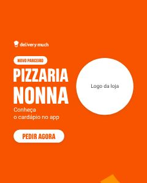 | **Logo da loja em destaque** `novoParceiro` | Novo parceiro, inauguração ou lojista da semana no feed: o nome da loja e o espaço grande do logo dela. | feed | parceiro | `inv/sorriso-arco.png` `logos/dm-h-branca.png` |
| 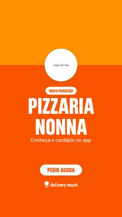 | **Perfil da loja** `perfilLoja` | Novo parceiro ou loja em destaque no story, com cara de perfil do app: a capa no alto e o logo da loja preso nela. | story | parceiro | `logos/dm-h-branca.png` |
| 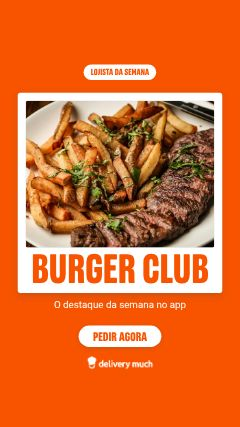 | **Polaroide da loja** `polaroideLoja` | Lojista da semana, parceiro novo ou um momento especial com foto no story: a foto numa moldura de polaroide com o nome embaixo. | story | parceiro, evento | `foto do franqueado` `logos/dm-h-branca.png` |
| 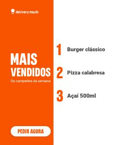 | **Ranking ao lado do título** `maisVendidos` | Mais vendidos, top da semana ou os favoritos da cidade no feed: o título de um lado e o ranking numerado do outro. | feed | parceiro, oferta, evento | `logos/dm-h-branca.png` |
|  | **Carrossel do ranking** `rankingCarrossel` | Mais vendidos ou top da semana em carrossel: a capa, o ranking numa placa branca e o convite para pedir. | carrossel | parceiro, oferta, evento | `inv/estrela-amarela.png` `inv/sorriso-arco.png` `logos/dm-h-branca.png` |
|  | **Capa com o logo da loja** `capaParceiro` | Capa da pasta do Deskfy (parceiro, campanha, data): o título à esquerda e o logo da loja ou o selo à direita. | capa | parceiro, evento, prospeccao, aviso, oferta | `logos/dm-h-laranja.png` |

## E · Datas e cidade

| Miniatura | Composição | Uso | Formato | Objetivos | Assets |
|---|---|---|---|---|---|
|  | **Manchete de Black Friday** `blackFriday` | Black Friday (ou outra data de desconto grande) no story: a chamada como manchete, o valor gigante e o ticket. | story | cupom | `inv/explosao.png` `inv/estrela-amarela.png` `logos/dm-h-branca.png` |
|  | **A data em destaque** `dataGigante` | Data comemorativa no feed (Dia das Mães, Natal, inauguração): o dia e o mês gigantes, o nome da data embaixo. | feed | evento, parceiro | `inv/estrela-amarela.png` `logos/dm-h-branca.png` |
| 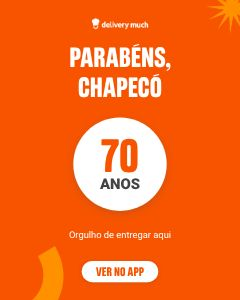 | **Anos no círculo** `anosCidade` | Aniversário da cidade (ou da loja) no feed: os anos gigantes num círculo branco, o parabéns em cima. | feed | evento | `inv/sorriso-arco.png` `inv/explosao.png` `logos/dm-h-branca.png` |
| 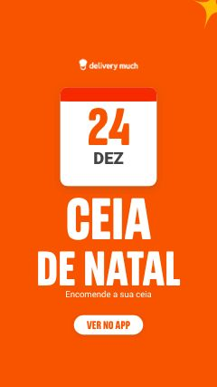 | **Folha do calendário** `calendarioStory` | Data comemorativa, feriado ou inauguração no story: a data numa folha de calendário e o nome dela grande embaixo. | story | evento, aviso, parceiro | `inv/estrela-amarela.png` `logos/dm-h-branca.png` |
|  | **Carrossel do cardápio** `cardapioCarrossel` | Festa junina, cardápio especial ou combos da data em carrossel: a capa, o cardápio em linhas e o convite. | carrossel | evento, oferta, parceiro | `inv/seta-rabisco.png` `inv/pattern-macarrao.png` `logos/dm-h-branca.png` |

## F · Operação e aviso

| Miniatura | Composição | Uso | Formato | Objetivos | Assets |
|---|---|---|---|---|---|
| 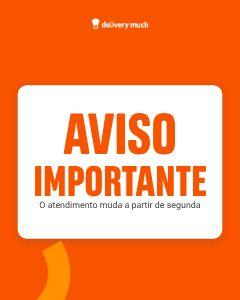 | **Aviso na placa branca** `avisoPlaca` | Aviso de operação no feed (horário especial, mudança, pausa): o recado inteiro numa placa branca, legível de longe. | feed | aviso, evento | `inv/sorriso-arco.png` `logos/dm-h-branca.png` |
| 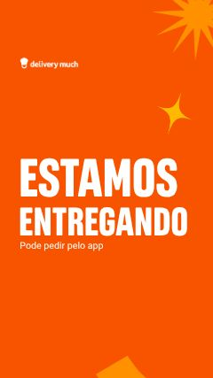 | **Recado em tipografia gigante** `avisoGigante` | Recado curto no story ("Estamos entregando", "Peça no app", "Abertos no feriado"): o título gigante ocupando a tela. | story | aviso, prospeccao, evento | `inv/explosao.png` `inv/sorriso-arco.png` `inv/estrela-amarela.png` `logos/dm-h-branca.png` |
| 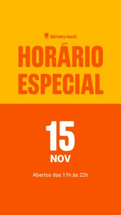 | **Placa amarela no alto** `avisoDividido` | Aviso com data ou horário no story (feriado, horário especial) ou convite com botão: o título na placa amarela do alto, o detalhe embaixo. | story | aviso, evento, prospeccao | `logos/dm-h-laranja.png` |
| 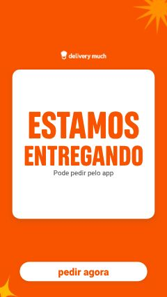 | **Pop-up de aviso** `avisoInapp` | Aviso ou convite no pop-up do app: o recado num cartão branco no meio da tela, com o botão largo embaixo. | inapp | aviso, prospeccao, evento | `inv/explosao.png` `inv/estrela-amarela.png` `logos/dm-h-branca.png` |
|  | **Cabeçalho do recado** `avisoEmail` | Cabeçalho de email de aviso, convite ou novidade: a marca de um lado e o recado na placa amarela do outro. | emailTopo | aviso, evento, prospeccao, parceiro | `logos/dm-h-branca.png` |

## G · Prospecção e comunidade

| Miniatura | Composição | Uso | Formato | Objetivos | Assets |
|---|---|---|---|---|---|
| 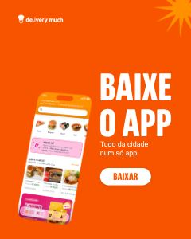 | **Celular à esquerda** `baixeApp` | Baixe o app, peça pelo app ou benefício do app no feed: o celular grande à esquerda e o convite à direita. | feed | prospeccao, beneficio, parceiro | `inv/explosao.png` `logos/dm-h-branca.png` `inv/celular-app.png` |
| 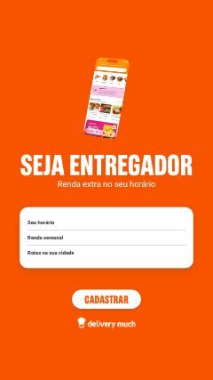 | **Convite com o celular** `conviteStory` | Seja entregador, seja parceiro ou baixe o app no story: o celular no alto, o convite e os motivos numa placa branca. | story | prospeccao | `inv/celular-app.png` `logos/dm-h-branca.png` |
|  | **Carrossel do convite** `conviteCarrossel` | Seja parceiro, seja entregador ou baixe o app em carrossel: o convite, os motivos em cards e o botão com o app. | carrossel | prospeccao | `inv/estrela-amarela.png` `logos/dm-h-branca.png` `inv/celular-app.png` |
| 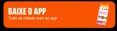 | **Banner com o celular** `appBanner` | Banner da home do app para convite (baixe, peça, indique, much+): o convite à esquerda e o celular à direita. | banner | prospeccao, beneficio, parceiro | `inv/celular-app.png` |
|  | **Cabeçalho centralizado** `obrigadoEmail` | Cabeçalho de email de agradecimento, data ou novidade: o título grande no centro, a marca em cima e grafismos nas laterais. | emailTopo | prospeccao, evento, aviso, parceiro | `inv/sorriso-arco.png` `inv/explosao.png` `logos/dm-h-branca.png` |
